# 可观测、可恢复的 AI 任务执行管线(MVP)——动漫素材逐帧风格化

**业务**:把一段动画/动漫素材批量处理成另一种画风(或替换人物)。流程是 6 道工序:
**素材校验与标准化 → 关键帧提取与拆分 → AI 逐帧风格化(豆包 Seedream) → 后处理与补帧 → 视频合成与音频对齐 → 打包与元数据归档**。
一条 1 分钟的素材约 1440 帧,抽成约 240 张关键帧交给模型,其余帧由补间生成;**模型调用是最贵、最容易失败、最需要恢复的一步**,
所以这个项目的重点不是"画得多好",而是:**某一帧失败、进程被杀、响应丢了、被限流、被审核拒绝时,不重复花钱、不重头来,而且能在页面上看到每一帧发生了什么**。

> **交付要求的 7 个问题的简要回答见 [`SUMMARY.md`](SUMMARY.md)**(token 与个人时间两处需作者自己填写)。
>
> 设计推导:[`docs/DESIGN.md`](docs/DESIGN.md)(执行引擎;**第 15 节是现行的逐帧流水线**,第 3.1 节的动画 DAG 是旧的引擎演示);Agent 层:[`docs/AGENT_PLAN.md`](docs/AGENT_PLAN.md)。

## 效果展示

### 素材与效果

左 = 原始素材(`samples/cba.mp4`,6.5 秒,320×568 竖屏,带音频),右 = 流水线成品(Seedream 5.0 pro,720 高,已合入原音频,27 张关键帧生成、其余帧运动补偿补帧)。

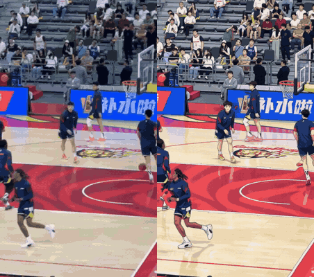

- 素材:[`docs/assets/source_cba.mp4`](docs/assets/source_cba.mp4)
- 成品(完整流水线真实输出):[`docs/assets/result_seedream5pro.mp4`](docs/assets/result_seedream5pro.mp4)
- 左右对比视频:[`docs/assets/compare_side_by_side.mp4`](docs/assets/compare_side_by_side.mp4);关键帧对比:

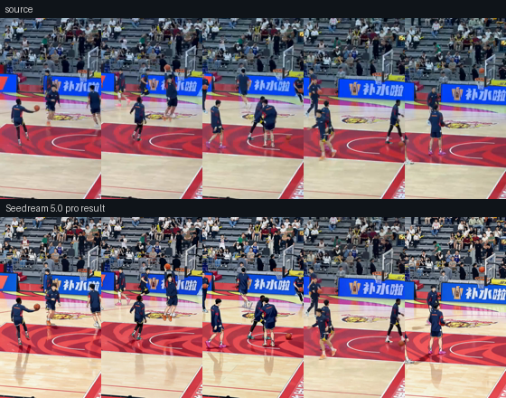

> 诚实说明:这是**一段素材、一次真实运行**的结果。风格化是整帧生成,模型会改变画面细节(例如地板倒影、人物脸部在关键帧之间会变,见 9.2);
> 素材来源与授权我没有逐一核实,仓库里放它只为演示,**公开使用前请自行确认授权**。对比图由 `scripts/make_readme_assets.py` 生成。

### 整体流程图

**系统结构**:决策(LangGraph + 模型)与执行(自写引擎 + worker)分层,两层各有自己的持久化。

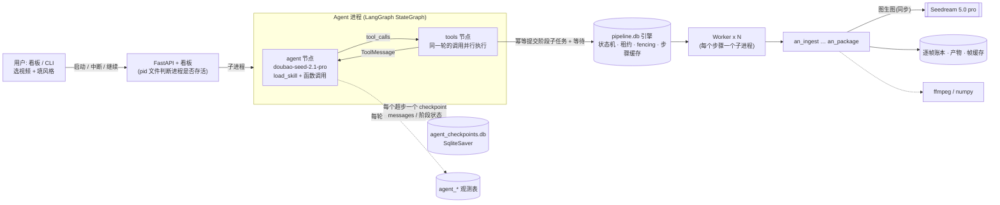

**流水线阶段**(每个节点是一个工具调用 = 一个引擎子任务;风格化与后处理按分块并行):

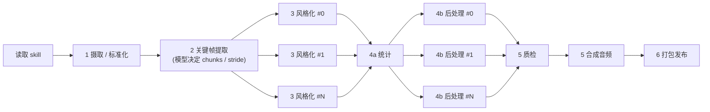

**失败、中断与恢复**:

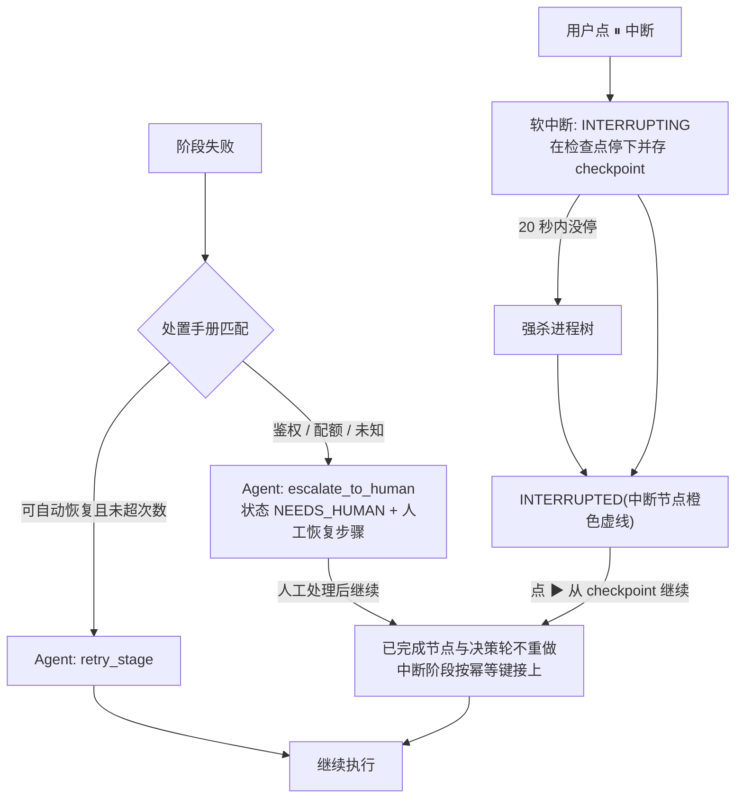

### 看板截图

**成功(真实运行)**:`doubao-seed-2.1-pro` 决策 + `doubao-seedream-5-0-pro-260628` 出图,10 轮决策、27 次图像调用、全部节点完成。
页面里的分阶段表就是"每阶段 token":决策模型提示 49,036 + 生成 1,927(推理 711);图像模型输出 450,212 tokens;风格化 316.8 秒、后处理 53.3 秒,总计 443.6 秒。

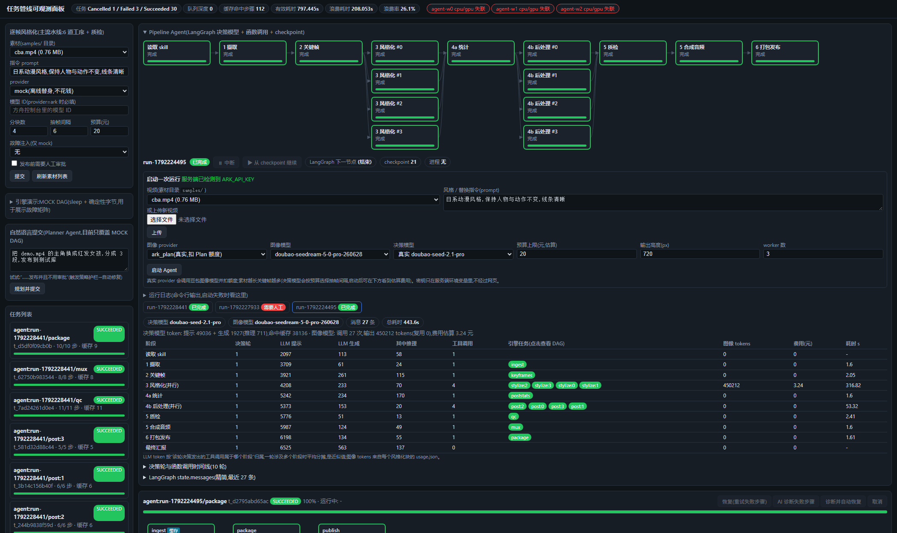

**失败(真实运行,配额用尽)**:换成"把人物换成企鹅"的指令再跑,4 个并行风格化块全部返回 `429 AccountQuotaExceeded`(同时夹杂 `AccountRateLimitExceeded`)。
决策模型尝试了一次 `retry_stage`(引擎侧该子任务已是 CANCELLED),随后调用 `escalate_to_human`,运行标记为"需要人工"并写明原因与步骤;图中红色节点是失败的风格化块,后面的节点保持待执行。

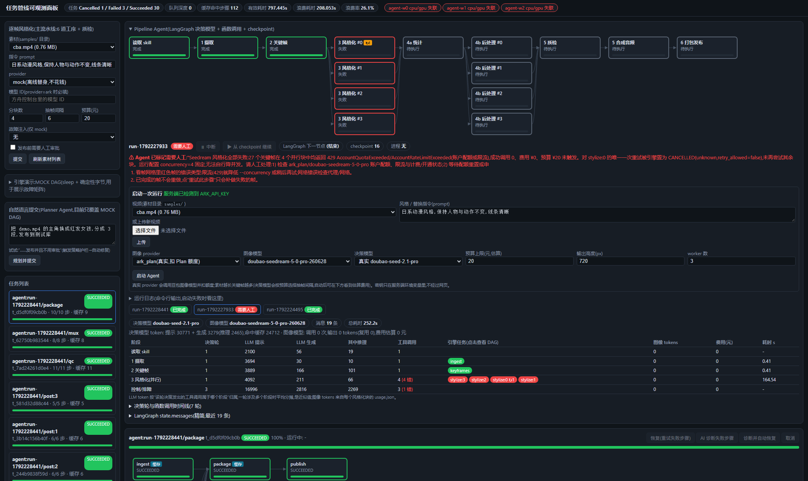

**中断与恢复**(下面三张是**离线演示**:脚本决策策略 + Mock 图像,不花钱;中断/恢复机制与真实运行相同,但**不是**真实模型/真实图像的运行):

| 运行中(后处理并行执行) | 点击"中断":在节点处停下,checkpoint 已保存 | 点击"从 checkpoint 继续" |
|---|---|---|
| 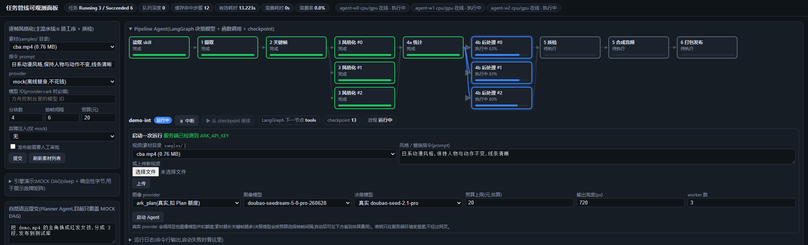 | 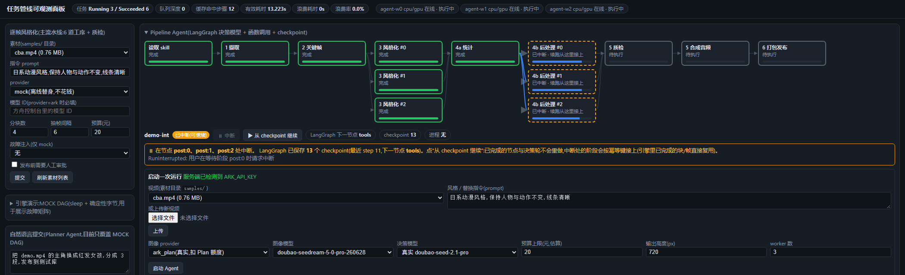 | 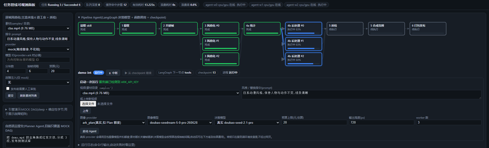 |

恢复后全部完成:

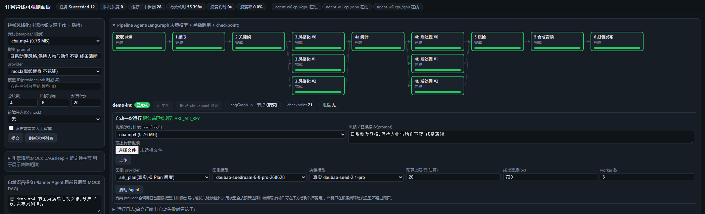

## 先读这个:什么是真的、什么不是

| 部分 | 状态 |
|---|---|
| 任务引擎(状态机/租约/fencing/重试/缓存/崩溃恢复) | **真实**,`kill -9` 级别的测试(见第 8 节) |
| 6 道工序里的视频处理(ffmpeg 转码/拆帧/合成/混音、numpy 调色与补间) | **真实**,跑过真实素材(`cba.mp4`) |
| **豆包模型调用** | 测试默认用离线 Mock(色阶分层 + 描边,**不代表真实模型画质**)。**真实调用已跑通完整任务**:Agent Plan + `doubao-seedream-5-0-flash-260915`(27 帧),以及 `doubao-seedream-5-0-pro-260628` 经 Pipeline Agent 跑通一次(27 帧、450,212 output tokens、443.6 秒)。**真实失败也见到了一种**:配额用尽时返回 `429 AccountQuotaExceeded`(与 `AccountRateLimitExceeded` 并存),原先被当成可重试的瞬时限流,已改为致命的 quota 并加了测试。**仍只验证了一段 6 秒素材;审核/欠费两类的真实错误码没有触发过**(见 9.2) |
| 失败恢复语义 | **在 Mock 服务器的"计费账本"上被证明**(每次调用落一个文件,测试直接数"花了几次钱"),真实服务的行为待接密钥后验证 |
| Dashboard(帧网格/用量/Pipeline Agent 流程图与中断按钮) | 通过 `node --check` 与接口测试,并用**无头 Edge 渲染截图**确认页面能显示(见效果展示);**没有人在真实浏览器里逐个点过按钮** |
| **Pipeline Agent(LangGraph + `doubao-seed-2.1-pro` 决策)** | 离线测试用**固定脚本策略**(不是智能体,只验证编排/并行/恢复/记账)。**真实决策模型 + 真实 Seedream pro 跑通了一次完整流水线**(10 轮决策,并行 4 路风格化与后处理);另有**一次真实失败**(配额用尽):模型尝试一次重试后调用 `escalate_to_human`,标记需要人工并给出原因与步骤。**这是 1 次成功 + 1 次失败的观察,不是评测**;模型在其他失败场景下的决策质量**未验证**(见 3.6、9.2) |
| 诊断 Agent(第 3.5 节)与旧 Planner | 诊断 Agent 已接入新流水线;Planner 仍只认旧的 MOCK 动画 DAG |

## 目录

1. [快速开始](#1-快速开始)
2. [实现方式与技术选型](#2-实现方式与技术选型)
3. [长任务执行、状态管理与失败恢复的设计考量](#3-长任务执行状态管理与失败恢复的设计考量)
4. [任务步骤与依赖关系](#4-任务步骤与依赖关系)
5. [哪些状态被持久化,为什么](#5-哪些状态被持久化为什么)
6. [AI coding 工具与 token](#6-ai-coding-工具与-token)
7. [个人时间花费](#7-个人时间花费)
8. [验证结果](#8-验证结果)
9. [失败案例分析:做错的、做不了的](#9-失败案例分析做错的做不了的)
10. [加分项对照](#10-加分项对照)

---

## 1. 快速开始

```powershell
py -3.11 -m venv .venv                       # 虚拟环境,依赖不污染本机
.\.venv\Scripts\python.exe -m pip install -r requirements.txt
.\.venv\Scripts\python.exe -m pytest -q      # 136 个测试,约 7 分钟(含真实 kill -9、混沌测试、真实视频处理)
```

**离线演示(Mock 模型,不花钱)**:

```powershell
$env:PIPELINE_MEDIA_DIR="samples"            # 素材目录;接口只接受目录下的纯文件名
python -m pipeline.cli --data data submit-style --source samples\cba.mp4 `
    --prompt "日系动漫风格,保持人物与动作不变" --chunks 4 --stride 6 --budget 50 --inject response_lost
python -m pipeline.cli --data data worker --id w1 --resources cpu,gpu --lease-ttl 5 --idle-exit 5   # 可起多个
python -m pipeline.cli --data data status          # 任务/步骤状态
python -m pipeline.cli --data data frames <task>   # 逐帧账本(--all 含正常帧)
```

`--inject` 预设:`transient`(单帧瞬时失败)、`crash`(步骤进程崩溃)、`moderation`(单帧被审核拒绝)、
`response_lost`(模型已处理但响应丢失)、`rate_limit`(429)、`auth_fail`(某一块的第一帧返回 401,致命,步骤 FAILED,等人工修复)。

**看板(实时看任务跑到哪)**:`python -m pipeline.cli --data data api --port 8000`,打开 http://127.0.0.1:8000 (前端每 1 秒轮询一次)。
可直达某任务/某节点:`http://127.0.0.1:8000/#t=<task_id>&s=<step_key>`。
提交面板选素材/提示词/故障注入;任务选中后出现**DAG**(节点颜色=状态,带进度%)、**逐帧网格**(颜色=状态,点格子看"源帧 vs 结果帧 + 调用次数/计费/错误")、**用量与预算条**、步骤详情(输入/输出/尝试历史/错误原因)、事件时间线。
注意:看板只是读数据库;任务要有 `worker` 进程在跑才会前进。

**失败 → 定位 → 修复 → 恢复**(`--inject auth_fail` 可复现):
1. 看板上失败节点标红,写着 `FAILED · PERMANENT`;点节点,步骤详情里有错误原因(如 `auth: HTTP 401`)、已完成多少帧、尝试历史;事件时间线里有 `STEP_STATUS ... FAILED`。
2. 修复原因(换密钥/开通模型/去掉被拒帧等)后,点节点上的**重试此步骤**(或任务按钮"恢复",或 `POST /api/tasks/<id>/steps/<key>/retry` / `.../resume`)。
3. 只有失败节点及其下游重新执行;已成功的节点保持,失败节点**从账本里已完成的帧继续**,不重复调用已成功的帧。
4. 可自动恢复的错误(瞬时错误、限流、worker 宕机、租约过期)不需要人工:自动退避重试;只有永久错误才停下等你。
截图:`samples/_out/dashboard_failed.png`(失败态)、`dashboard_recovered.png`(恢复后)。

**接真实豆包(会花钱/扣额度,先小范围)**:

```powershell
$env:ARK_API_KEY="你的密钥"          # 只从环境变量读取;不进任务参数、数据库、日志
# 普通按量付费接口:--provider ark;Agent Plan 订阅(专属密钥 + 专属路径 /api/plan/v3):--provider ark_plan
python -m pipeline.cli --data data submit-style --provider ark_plan --model doubao-seedream-5-0-flash-260915 `
    --source samples\cba.mp4 --prompt "日式动漫风格,赛璐璐上色,清晰的线稿,保持人物、动作与构图不变" `
    --stride 6 --chunks 4 --concurrency 3 --budget 10
python scripts/smoke_real.py ark_plan doubao-seedream-5-0-flash-260915 samples/cba.mp4 2.0   # 单帧冒烟(只调 1 次)
python scripts/export_run.py data <task_id> samples/_out/result                             # 导出成品与对比图
```

两个入口的密钥**不通用**(用普通密钥访问 `/api/plan/v3` 返回 401;Agent Plan 密钥访问普通接口的行为我没测)。
Agent Plan 按套餐额度抵扣而不是按元计费,所以下面的"元"只是**用单价估算的预算护栏**,不是账单。

提交时按"单价 × 预计关键帧数"做预算检查,**超预算在调用接口之前就失败**。单价默认 0.12 元/张,**只用于估算,以账单为准**。

## 2. 实现方式与技术选型

| 层 | 选型 | 理由 |
|---|---|---|
| 引擎 | Python 标准库 + SQLite(WAL) | 题目偏好"更简单、更可控、更容易解释正确性";没有用 Celery/Temporal/Redis |
| 步骤执行 | 每个步骤一个子进程,JSON 行协议上报 | 卡死/超时/取消可以真正 `kill`;只有父进程写库 |
| 接口/看板 | FastAPI + 单文件 HTML | 核心不依赖它 |
| 模型 | 豆包 Seedream 图生图(方舟 `POST /api/v3/images/generations`,同步,`b64_json`) | 同步接口没有"任务 id 可续查",所以恢复要靠**自己的逐帧账本**而不是服务端任务 |
| 视频 | ffmpeg(优先系统的,否则 `imageio-ffmpeg` 自带)+ numpy + Pillow | 不引入 OpenCV |
| 流水线执行 | **自写引擎**(租约/fencing/缓存/崩溃恢复)| 见下方"为什么不用现成框架" |
| **流水线决策层(Pipeline Agent)** | **LangGraph** `StateGraph(agent ⇄ tools)` + `doubao-seed-2.1-pro`(函数调用)+ `SqliteSaver` checkpoint | 模型读 skill → 以工具调用驱动 6 个阶段,同一轮发出的多个工具调用并行执行;每个工具 = 向引擎提交一个"阶段子任务";见第 3.6 节 |
| 失败诊断 Agent | **LangGraph**(`StateGraph` + `interrupt` + `SqliteSaver` checkpoint)+ 自写处置手册 | 只有这一处用 LangGraph:它要"暂停等人确认、进程重启后继续",正好是它的强项;见第 3.5 节 |
| Planner Agent / MCP | OpenAI 兼容客户端 + MCP | 见 `docs/AGENT_PLAN.md`;Planner **只认旧 Mock DAG,没有接入新流水线** |
| 观测与 token 统计 | **自建**(SQLite 表 + 看板),未用 LangSmith/Langfuse/OpenTelemetry | 见下方"为什么不用现成框架" |

**为什么不用现成框架(诚实版)**:
- **"执行"不用 LangGraph,"决策"用**:LangGraph 是单进程内的图执行与状态保存,不提供本题要考察的东西——租约/心跳、fencing token、崩溃后"可能已计费"的歧义处理、子进程 kill、步骤缓存、跨 worker 调度。
  这些要靠数据库里的状态机做,我选择自己写并用 100+ 个测试(含真实 `kill -9`)证明它;代价是**我自己维护了一个调度引擎**,生产环境更应该用 Temporal 等成熟系统。
  所以**步骤内部**的断点恢复是引擎自己的(步骤级 `checkpoint`、逐帧账本、租约回收)。**决策层**(第 3.6 节)用 LangGraph:模型的对话/工具调用进度存在 LangGraph checkpoint,
  两层各管各的状态,互不替代。
- **观测与 token 统计不用现成框架**:这里要统计的是**图像生成接口返回的 `usage`**,并和逐帧账本(调用次数、`maybe_billed`、缓存复用)对账——LangSmith/Langfuse 面向 LLM 对话的 trace,没有"帧"这个维度,也不认 Seedream 的 `output_tokens`;
  OpenTelemetry/Prometheus/Grafana 能做指标与链路,但需要额外起服务、对账逻辑仍要自己写,与题目"MVP、可解释"的取向不符。
  代价:**看板是单文件 HTML、轮询而非推送、没有鉴权、没有历史趋势与告警**;LLM 调用(Agent 用的)的追踪表 `llm_calls` 也是"最小自建版"。
  如果做成生产系统,我会把事件导出为 OpenTelemetry span/metric,看板交给 Grafana,保留账本对账逻辑。这一步**没做**。

**为什么逐帧账本放在文件系统而不是数据库**:恢复时要信任的是"磁盘上已有的、校验过 hash 的结果帧",而不是某个数据库行。
`ledger/<idx>.json` 与 `styled/<idx>.png` 在步骤的 `work_dir`(跨尝试保留)里;数据库的 `items` 表只是**派生的只读观测视图**(带 fencing 的 upsert,旧 worker 写不进去)。

**模块**

| 模块 | 职责 |
|---|---|
| `pipeline/engine.py` / `worker.py` / `step_runner.py` / `db.py` | 引擎:状态机、租约/fencing、重试、缓存、子进程监督(唯一写入口 `_transition`) |
| `pipeline/steps/anime.py` | 6 道工序的 8 个步骤类型(`an_ingest … an_package`) |
| `pipeline/doubao.py` | `MockDoubao`(可注入故障 + 计费账本)、`ArkDoubao`(真实客户端)、错误分类 `classify_http_error` |
| `pipeline/media.py` | ffmpeg/ffprobe 封装 |
| `pipeline/templates.py` | `frame_style_task`(流水线 DAG)、故障注入预设;`animation_swap_task` 是旧 MOCK DAG,**保留为引擎测试夹具** |
| `pipeline/api.py` + `web/index.html` | REST 与看板 |
| `pipeline/agent/diagnosis.py` + `runbook.py` | 失败诊断 Agent + 处置手册:已接入新流水线(见 3.5) |
| `pipeline/agent/orchestrator.py` | **Pipeline Agent**:LangGraph 状态图(`agent`/`tools` 节点)、checkpoint、`run_report`(分阶段 token) |
| `pipeline/agent/pipeline_tools.py` + `stages.py` | 13 个工具(参数用 pydantic 校验)与"阶段 → 引擎子任务"的切分/幂等提交/等待/汇总 |
| `pipeline/agent/agent_llm.py` | `ArkChat`(`doubao-seed-2.1-pro`,函数调用,密钥只读环境变量)与离线的 `ScriptedAgentLLM` |
| `skills/anime-style-pipeline/SKILL.md` | 流水线的阶段定义、参数决策规则、失败处置——Agent 启动时用 `load_skill` 读取 |
| `pipeline/agent/planner.py` + `mcp_server.py` | Planner / MCP,只认旧 Mock DAG |

## 3. 长任务执行、状态管理与失败恢复的设计考量

**一句话**:至少一次执行 + 恰好一次提交;"谁在跑"由租约判定,"能不能提交"由 fencing token 判定;状态与历史在同一个事务里变化。
引擎部分(租约、fencing、停滞检测、失败分类、进程隔离、结果复用、审批)的论证见 `docs/DESIGN.md` 第 2–8 节。

**新增的"逐帧"这一层**(模型调用步骤特有):

1. **一帧一条账**。每帧的状态 `PENDING → INFLIGHT → DONE | RETRY | DEGRADED | FAILED` 落在 `ledger/`。发请求**之前**先写 `INFLIGHT`。
2. **崩溃后的歧义**:恢复时看到 `INFLIGHT` 说明"请求发出去了但没记下结果",**服务端可能已经计费**。我们不假装知道:
   这一帧重做,账本里标 `maybe_billed`,看板用白框标出,用量面板单独列"可能多付 N 张"。**多付上限 = 并发度**(崩溃时最多 `concurrency` 帧在途)。
3. **帧级重试在步骤内部**:瞬时错误/限流只重做那一帧(指数退避,429 遵循 `Retry-After`),不会让整个步骤重来。
4. **帧级缓存(跨任务)**:`sha256(模型, 提示词, 参考图, 源帧像素, 尺寸…)` → 结果图,放在 `data/framecache`。同一素材再提交、换分块数重提交 → **0 次接口调用**;改提示词 → 全部失效(测试验证)。
5. **审核拒绝是帧级的永久错误**:默认降级为"原帧直通"(记 `DEGRADED`),超过 `max_degraded_ratio` 才判整个步骤失败;
   也可 `on_reject=fail` 严格模式。之后可以用 `frame_overrides` **只为那一帧换提示词重提**,其余帧命中帧缓存、不花钱。
6. **致命错误立刻停**:密钥无效/欠费/请求格式错误(`FatalError`)→ 步骤永久失败,**不再继续烧钱**。未知的 4xx 也按致命处理(宁可停下来让人看,也不无限重试)。
7. **预算在花钱之前检查**:关键帧数在工序 2 之后才确定,工序 3 开始前用"帧数 × 单价"对比预算。
8. **出了问题怎么办**:每个步骤的"笔记"(note)在成功和失败时都保存,看板里能看到失败那次尝试的帧账本;**产物只在成功时登记**。

**失败场景一览**(详表与测试见第 8 节):单帧瞬时失败 / 限流 / 审核拒绝 / 响应丢失 / 返回乱码 / 步骤崩溃 / worker 被杀 / 密钥失效 / 欠费 / 超预算 / 坏素材 / 素材被替换 / 质检不过。

### 3.5 失败分层:谁来恢复(引擎 / Agent / 人)

| 失败场景 | 引擎自动恢复? | Agent(`--auto`) | 需要人时,Agent 给出的手册 |
|---|---|---|---|
| 单帧瞬时错误 / 429 限流 | **是**:帧内退避重试,用尽再引擎级重试 | — | — |
| worker 被杀 / 租约过期 / 进程崩溃 | **是**:租约回收、从账本续跑 | — | — |
| 重试预算耗尽的瞬时/超时/卡死/部分帧失败 | 否(FAILED) | **自动重试**,每步最多 2 次 | 超过 2 次 → 标记需要人工,提示看红色帧、降并发、看 stderr |
| 宿主机内存不足致 ffmpeg 失败 | 重试预算内自动 | **自动重试**(同上) | 提示关程序/查页面文件/看 stderr.log |
| 鉴权失败(401) | 否,**停止烧钱** | **不重试**,标记需要人工 | 检查 `ARK_API_KEY`、重启 worker、`ark` 与 `ark_plan` 密钥不通用 |
| 欠费/额度不足 | 否 | 不重试 | 查余额/套餐用量,充值后手动重试 |
| 模型未开通 / 模型 ID 不存在或已下线 | 否 | 不重试 | 开通模型或换模型重新提交 |
| 未知 4xx(请求参数被拒) | 否 | 不重试 | 看 code/message 对照参数 |
| 超预算保护线 | 否(主动停止) | 不重试 | 提高 `--budget` 重新提交(已完成帧不重复计费) |
| 内容审核拒绝(`on_reject=fail`)/ 降级帧过多 | 否 | 不重试 | `frame_overrides` 换提示词重新提交,或改 `passthrough` |
| 质检硬失败 | 否 | 不重试 | 看 qc 报告,改参数重新提交 |
| 坏素材/素材被改 | 否 | 不重试 | 修复素材重新提交 |
| 反复使 worker 失联(疑似毒丸) | 到次数上限后 FAILED | 不重试 | 先看 worker 日志与 stderr.log 再重试 |
| 没见过的错误 | 否 | 不重试 | 通用排查步骤 |

**Agent 做了什么**(`pipeline/agent/diagnosis.py`,LangGraph 状态图 `collect → diagnose → {auto_act | human_gate → act | report}`):
1. **分析**:收集失败步骤的错误、尝试历史、事件,让 LLM 给出根因与建议(默认 `MockLLM` 的规则,配 `OPENAI_API_KEY` 才用真实模型);
2. **手册**(`runbook.py`)**只限制模型、不放大权限**:模型说"重试"但手册判定无益(鉴权/欠费…)→ 降级为人工;模型输出无法解析 → 绝不执行写操作;
3. **自我恢复**:只有手册白名单(瞬时、部分帧失败、内存不足)且开启 `--auto`,Agent 才不经人确认直接 `retry_step`,**每个步骤最多 2 次**;
4. **无法恢复**:写入诊断记录 `result.needs_human=true`,追加事件 `AGENT_NEEDS_HUMAN`(带人工恢复步骤清单),看板"AI 诊断"面板显示"⚠ 需要人工处理"和编号步骤;
5. **人在回路**:非白名单但模型建议重试的场景,用 LangGraph `interrupt` 暂停等人确认;进程重启后用同一 `thread_id` 继续,**不会重复调用 LLM**;
6. Agent 只有 `retry_step` 一个写权限,没有批准/取消。同一次失败按 `attempt_no` 只诊断一次。

使用:`python -m pipeline.cli --data data agent-watch --auto`(持续扫描),或看板任务栏"AI 诊断失败步骤 / 诊断并自动恢复"。
实测(Mock 豆包 + 故障注入,截图 `samples/_out/dashboard_agent_needs_human.png`):`auth_fail` 任务被标记"需要人工"并列出 4 步;
`rate_limit` 任务(引擎重试预算设为 1 以便走到 FAILED)被 Agent 自动重试后继续执行完成。测试见 `tests/test_agent_runbook.py`。

**必须说清的局限**:
- 默认是 `MockLLM` 的**规则**,不是真实模型的诊断。没有用真实 LLM 评估过诊断质量,"LLM 理解错误"的部分**未验证**;安全性来自手册与护栏,不来自模型。
- 手册靠**匹配本项目自己的错误文本**,文本改了要同步改(测试用真实文本做回归);豆包真实的审核/欠费错误码没有触发过,对应分支是按猜测写的;`429 AccountQuotaExceeded` 是真实见到的(见效果展示),原先被手册当成可重试的"部分帧失败"并给出了不贴切的人工步骤,已改为致命的 quota 分类(`classify_http_error`)。
- 自动恢复的白名单与"最多 2 次"是我手设的;"没有人在看时能不能自动重试"是安全与便利的取舍,默认关闭。
- 没有"自动改参数后重试"(例如降并发、换提示词):这类恢复会改变任务含义,只给人工建议。
- 看板不会主动弹出提醒,需要看"AI 诊断"面板或事件时间线;没有邮件/IM 通知。

### 3.6 Pipeline Agent:LangGraph + 决策模型 + 函数调用 + checkpoint

```
            ┌──────────────── LangGraph StateGraph ────────────────┐
 start ──▶  │  agent(doubao-seed-2.1-pro)  ──有 tool_calls──▶  tools │ ──▶ 回到 agent
            │          │ 无 tool_calls / 已升级人工 / 超轮数          │      (同一轮的多个调用并行)
            └──────────▼─────────────────────────────────────────────┘
                      END      state = {messages, cfg, stages, turns, escalated}  ← 每个超步写一个 checkpoint
```

- **模型读 skill**:第一轮必须调用 `load_skill("anime-style-pipeline")`,拿到 `skills/anime-style-pipeline/SKILL.md`(阶段、参数决策规则、失败处置);之后每一步只能通过工具调用推进。
- **每个步骤 = 一个工具**:`ingest_video`、`extract_keyframes(chunks,stride,max_gap)`、`stylize_chunk(chunk)`、`poststats`、`postprocess_chunk(chunk)`、`quality_check`、`mux_audio`、`package_and_publish`,外加 `get_run_status`、`inspect_frames`、`retry_stage`、`escalate_to_human`。参数用 pydantic 校验(范围、`max_gap>=stride`、路径穿越),非法参数返回 `ERROR` 让模型改,**不执行**。
- **风格化/人物替换并行**:模型在同一轮里发出 N 个 `stylize_chunk`,`tools` 节点用线程池同时执行,各自成为引擎里的一个子任务,由多个 worker 并行拉取;调用 `doubao-seedream-*` 的是引擎里的 `an_stylize` 步骤(图像模型 ID 来自运行配置,不是模型临时决定的,避免它改用更贵的模型)。
- **模型的权限**:能调 13 个工具;**不能**批准/取消任务、不能改预算、不能换图像模型。`retry_stage` 受处置手册限制(鉴权/欠费等不可重试类直接拒绝并返回人工步骤,同一阶段自动重试有次数上限);无法恢复时调用 `escalate_to_human`,图结束并把 `NEEDS_HUMAN` 与人工步骤记入运行记录。
- **两层状态各管各的**:
  - LangGraph checkpoint(`data/agent_checkpoints.db`,`SqliteSaver`):`messages`(模型与工具之间传递的全部消息)、各阶段状态、轮数;
  - 引擎数据库(`data/pipeline.db` + 产物目录)才是任务真相:每个阶段是一个**幂等提交**的子任务(幂等键 `agent:{thread}:{stage}:{参数哈希}`),上游产物通过 `an_import` 以内容哈希引用。
- **中断后继续**:`python -m pipeline.cli agent-resume <thread>`(或看板"从 checkpoint 继续")= 从最近 checkpoint 接着跑。已完成的决策轮**不会重新调用模型**(不重复花 token);被打断的工具调用会重新执行,但因为幂等键与步骤缓存/逐帧账本,**不会重复提交子任务、不会重复调用图像模型**(测试里在第 5 轮用 `KeyboardInterrupt` 模拟中断再续跑,图像模型计费账本不增加;**不是真实 `kill -9` 杀整个进程**,SQLite 事务保证 checkpoint 不会写一半,但这一层我没做进程级杀死测试)。
- **可观测**:
  - 表 `agent_runs / agent_turns / agent_tool_calls / agent_stage_runs` 记录每一轮决策的 token(接口返回的 `usage`,含推理 token、缓存命中)、工具调用、阶段状态;
  - `GET /api/agent/runs[/{thread}]` 与看板顶部"Pipeline Agent"面板:分阶段表(决策 token、工具调用、引擎子任务、**图像模型 token**、费用估算、耗时)、决策轮与函数调用时间线、LangGraph 的下一节点/checkpoint 数/消息、"从 checkpoint 继续"按钮;
  - 命令行:`agent-status [thread]`。
- **流程图与中断按钮**(看板顶部,没有任何运行时也先显示整条流程):节点 = 读取 skill → 摄取 → 关键帧 → 风格化 #0..#N(并行)→ 统计 → 后处理 #0..#N(并行)→ 质检 → 合成 → 发布,
  状态(待执行/执行中+进度/完成/失败/已中断)来自阶段记录与工具调用记录,每秒刷新,点击节点跳到对应引擎任务的 DAG。
  "⏸ 中断"= **软中断优先、硬杀兜底**:先把运行置为 `INTERRUPTING`,Agent 在检查点停下(两轮决策之间、等待阶段的轮询里、提交阶段之前),保存 checkpoint,状态记为 `INTERRUPTED`;
  20 秒内没停下(例如卡在一次模型请求里)就强制终止整个进程树(Agent + 它拉起的 worker)。中断处的节点显示为橙色虚线框;"▶ 从 checkpoint 继续"= `agent-resume`。
  Agent 进程被强杀/崩溃、记录仍是 RUNNING 时,看板按"进程已不在"显示为已中断并允许继续;进程还活着时拒绝重复继续(pid 文件 + 存活探测)。
  **中断的代价**:软中断只停下 Agent,**正在途中的图像请求在 worker 被终止时会被丢弃**,恢复时这些帧可能重新请求(账本会标出"可能多付");如果 worker 是你另外启动的(`--workers 0`),软中断不会停掉它们,已提交的阶段会继续跑完(继续花钱),需要自己停 worker。

**从看板启动**:先在启动 API 的终端里 `$env:ARK_API_KEY="..."`,再 `python -m pipeline.cli --data data api --port 8000`,打开 `http://127.0.0.1:8000/`,
顶部"Pipeline Agent"面板里选择/上传视频(`POST /api/media`,存到 `samples/`)、填写风格指令、选图像模型与预算后点"启动 Agent"(`POST /api/agent/runs` 另起子进程,日志在 `data/agent_logs/`)。
服务端没有密钥时真实调用在起子进程之前就被拒绝。

```powershell
$env:ARK_API_KEY = "<专属密钥,只放环境变量>"
.\.venv\Scripts\python.exe -m pipeline.cli agent-run --source samples\cba.mp4 --prompt "日系动漫风格,保持人物与动作不变" `
    --provider ark_plan --model doubao-seedream-5-0-pro-260628 --agent-model doubao-seed-2.1-pro --budget 20 --workers 4
# 无密钥/CI:--agent-llm scripted --provider mock(固定脚本策略,不花钱)
```

**真实运行记录**(`doubao-seed-2.1-pro` 作决策模型,**图像模型是 Mock**,素材 `cba.mp4`,线程 `real-llm-1`;数字取自 `agent_turns` 表):
10 轮决策,提示 48,325 + 生成 1,768 token(其中推理 676,命中缓存 39,160)。模型先 `load_skill`,依次摄取 → 关键帧(自选 `chunks=4,stride=6,max_gap=24`)→ **一轮并行发出 4 个 `stylize_chunk`** → 统计 → **一轮并行 4 个 `postprocess_chunk`** → 质检 → 合成 → 发布,最后给出文字汇报。
这只能说明"模型能按 skill 与工具协议把全流程走通";**图像费用与 token(27 次调用、7,668 output tokens)是 Mock 产生的,不是真实 Seedream 数字**。

**分阶段 token 的口径与局限**:
- 决策模型的 token 按"该轮发出的工具调用属于哪个阶段"归属,一轮跨多个阶段时**平均分摊**——是近似,不是精确归因;没有工具调用的最后一轮归入 `final`;
- 图像模型 token 来自每个风格化块的 `usage.json`;整块命中步骤缓存时本次记为 0、原值计入"复用";
- `ScriptedAgentLLM` 的 token 是**按字符数估算**并标 `~`/`estimated`,不要当真实用量;
- Seedream 的 token 是否等同于计费口径、Agent Plan 下如何折算套餐额度,**我没有核实**。

**必须说清的局限**:
- 决策质量**只用一个素材、一次成功路径**验证过;失败场景下真实模型是否会正确选择 `retry_stage`/`escalate_to_human` 没有用真实模型测过(测试里是脚本策略),模型也可能反复调用无效参数或不按 skill 走——有 `max_turns`(默认 40)与参数校验兜底,但**兜底不等于决策正确**;
- 模型能看到的是工具返回的摘要(已压缩到有限长度),看不到画面,**不做画质判断**(没有 VLM 质检);
- 阶段内部仍是引擎的 6 道工序,Agent 没有减少工程复杂度,只是把"参数决策、阶段顺序、失败后的选择"交给了模型;
- 工具节点用线程池并行,上限 `--max-parallel`(默认 8);同一运行里同一阶段重复调用会命中同一幂等子任务,不会重复执行;
- 这一层是**第二套状态**(checkpoint 库 + 4 张表),与引擎数据库之间不是同一个事务,崩溃后的一致性靠"引擎侧幂等 + 恢复时按引擎状态重新判断"保证,而不是靠分布式事务。

## 4. 任务步骤与依赖关系

```
ingest ─► keyframes ─► [reference] ─► stylize_0..N-1 (gpu 车道) ─► poststats ─► post_0..N-1 ─► qc ─► mux ─► [human_approval] ─► package ─► publish
                                                                                   ▲
                       post_i 依赖 stylize_i 与 stylize_{i+1}(块边界的补间要读下一块的第一张关键帧)
```

| 工序 | 步骤 | 做什么 | 失败语义 |
|---|---|---|---|
| 1 校验与标准化 | `ingest` | 探测、转 1080p/24fps/H.264、分离音轨;统计解码错误数 | 文件不存在/素材损坏/过短 → **永久失败**,后面步骤都不会开始;转码失败 → 可重试 |
| 2 关键帧与拆分 | `keyframes` | 96px 灰度缩略图序列 → 选关键帧(首尾必选;**镜头切换点两侧都选**,补间不跨镜头;与上一关键帧几乎相同的候选跳过;间隔过大则强制补选) → 只对选中帧全分辨率取帧,输出时间线 | 同上 |
| 2b 参考图 | `reference`(可选) | 人物参考图,作为每次请求的第二张图 | |
| 3 AI 风格化 | `stylize_i`(`resource=gpu`,**外部并发车道**) | 逐帧调模型,账本/缓存/重试/降级(见第 3 节) | 致命错误 → 永久;预算不够 → 永久;**可重入**:被杀后从账本继续 |
| 4 后处理 | `poststats` → `post_i` | 每关键帧向平滑后的目标做色彩统计匹配 + 轻度去噪;关键帧之间补帧:默认 `interp=mc`,用**源视频**的相邻帧估计块匹配运动,把前后两张风格化关键帧按运动扭曲到当前时刻再融合(`pipeline/interp.py`);`interp=blend` 为旧的线性混合;每块直接编码成 mp4 分段 | mc 只有平移模型,有残余扭曲;不能修复相邻关键帧本身的风格不一致 |
| 质检 | `qc` | **硬检查**(帧数、尺寸、黑帧)不过 → 永久失败;**软检查**(闪烁比、降级比例、可能重复计费)只告警,`qc_strict` 才失败 | 失败不触发上游重算 |
| 5 合成与对齐 | `mux` | 分段无损拼接 + 音轨(`-af apad -t <时长>` 对齐;静音素材补静音轨) | |
| 6 打包与归档 | `package` → `publish` | 成品、缩略图、`metadata.json`(参数、耗时、调用/计费用量、质检);`publish` 带幂等键、不进缓存 | 重复执行只发布一次 |

- 依赖在提交时校验(key 唯一、依赖存在、无环),`fan-out` 在提交时静态展开(分块数固定)。
- "可运行"是派生谓词:`状态 ∈ {PENDING, RETRY_WAIT} ∧ 到点 ∧ 依赖全部 SUCCEEDED ∧ worker 具备所需资源`。
- 步骤缓存 key = `sha256(类型, 版本, 参数, 输入产物 hash)`;故障注入不参与 key。

## 5. 哪些状态被持久化,为什么

| 位置 | 内容 | 为什么 |
|---|---|---|
| SQLite `tasks / steps / step_deps / attempts / events` | 规格、状态、`attempt_no`(fencing)、租约、检查点、每次尝试的错误类别与笔记、追加式事件 | 恢复的依据;失败史;时间线 |
| `artifacts` / `step_cache` + `data/artifacts/<sha256>` | 内容寻址产物与缓存映射 | 复用;读时校验完整性 |
| SQLite `items`(**派生,只读观测**) | 每帧的状态、调用/计费/可能重复计费、耗时、错误(带 fencing 的 upsert) | 看板的逐帧网格;**不是恢复依据** |
| `data/work/<step>/ledger/*.json`、`styled/*.png`(**恢复的事实来源**) | 逐帧账本与结果图,跨尝试保留 | 崩溃后判定"哪些帧已完成、哪些帧歧义" |
| `data/framecache/` | 跨任务的帧结果缓存 | 同帧同参数不重复花钱 |
| `data/mock_doubao_billing/`(仅 Mock) | 每次模型调用一个文件 | 测试里"数花了几次钱"的依据 |
| `data/agent_checkpoints.db`(LangGraph `SqliteSaver`) | Pipeline Agent 的 `messages`、阶段状态、轮数,每个超步一个 checkpoint | 中断后从最近 checkpoint 续跑,已完成的决策轮不重调模型 |
| SQLite `agent_runs / agent_turns / agent_tool_calls / agent_stage_runs` | 运行状态、每轮决策 token、工具调用与结果、阶段 ↔ 引擎子任务映射 | 可观测与分阶段 token 报告;**不是恢复依据**(恢复看 checkpoint + 引擎) |
| `plans / llm_calls / diagnoses`、Diagnosis Agent 的 LangGraph checkpoint | 旧 Agent 层 / 诊断 Agent | 见 `docs/AGENT_PLAN.md` 与 3.5 |

**刻意不持久化**:内存调度队列(由数据库谓词派生)、步骤内未存档的局部状态(丢了就从账本/检查点/开头重算)、每一次进度更新(随心跳节流)、日志全文。
**密钥永远不落盘**:只在 `ARK_API_KEY` 环境变量里。

## 6. AI coding 工具与 token

- **工具**:Cursor(Agent 模式,对话式协作完成设计、实现、测试与调试)。
- **token 用量(估计)**:整个项目约 **1000–2000 万 token 量级**,绝大部分是长对话里反复读取的缓存上下文,新生成的只占很小一部分。**这是按对话轮数与上下文长度粗估的,不是读出来的;以 Cursor Usage 页为准。**
- 消耗最多的部分(定性判断,请与用量页对照):引擎核心的设计与调试;故障矩阵/混沌测试;逐帧账本与恢复语义的设计与测试;反复更换技术路线(见 9.1 第 8 条)。

## 7. 个人时间花费

(估计,不含 LLM 直接生成的部分;具体小时数请按实际记录调整)花得最多的依次是:① 验证恢复语义——读懂并质疑"至少一次 + 恰好一次"的论证,亲手跑强杀、限流、中断演示,确认账本数得对;② 真实豆包联调——开通模型、搞清专属密钥与路径、试参数,这一步推翻了先写框架时的三个假设;③ 判断效果与取舍——看成品有无重影、哪些失败该自动重试、哪些必须人工。

## 8. 验证结果

> 所有数字来自本仓库的测试与脚本,可复现。**模型调用均为 Mock**;Mock 服务器的"计费账本"是恢复语义的判据。

### 8.1 测试总览(136 个,全部通过,约 7 分钟,Windows)

| 文件 | 个数 | 内容 |
|---|---|---|
| `test_anime_pipeline.py` | 15 | 新流水线的端到端与恢复语义(见 8.2) |
| `test_doubao_client.py` | 13 | `ArkDoubao` 对本地假服务器:请求形态、鉴权头、b64 解码、429(含真实见到的 `AccountQuotaExceeded` 与 `AccountRateLimitExceeded`)/401/500/审核/未知 400 的映射、连接失败=未发出、缺密钥/缺模型 |
| `test_api_style.py` | 2 | 提交校验、帧账本/图片/用量/报告接口、路径参数拒绝穿越 |
| `test_engine.py` / `test_failures.py` / `test_chaos.py` / `test_smoke.py` | 11 / 14 / 1 / 1 | 引擎:见 8.3 |
| `test_pipeline_agent.py` | 18 | Pipeline Agent:并行风格化、软中断后 checkpoint 续跑不重复花钱、**真实子进程中断(API 强杀进程树)后 CLI 续跑**、流程图状态、中断/继续接口的守卫、素材上传校验、幂等阶段、跨线程缓存复用、失败重试/升级人工、手册拒绝、参数校验、`ArkChat`(MockTransport)、API |
| `test_agent_*` / `test_eval.py` / `test_api.py` | 9+19 / 2 / 3 | 旧 Agent 层与基础接口 |

### 8.2 逐帧流水线的恢复语义(Mock 服务器计费账本为判据)

| 场景 | 实测结论 |
|---|---|
| 完整运行(6 道工序,小片段) | 镜头切换点两侧都被选为关键帧;成品用 ffmpeg 完整解码,帧数与标准化素材一致、带音轨;`package` 元数据里的计费张数 = 关键帧数 = 账本记录数;结果帧确实被改动 |
| 同一素材再提交 | **0 次模型调用**(全部命中帧缓存) |
| 改提示词 | 帧缓存全部失效,按新提示词重新计费 |
| 单帧瞬时错误 | 帧内重试,**只有该帧多一次调用**,其余帧各一次 |
| 一帧耗尽重试 | 步骤失败;重试该步骤时**只重做这一帧** |
| 步骤进程崩溃 | 重启后**只重做在途的帧**(≤ 并发度);最终结果帧与无故障基线**逐字节相同** |
| 响应丢失(服务端已处理、客户端没收到) | **恰好多付一次**,且被记录为 `maybe_billed`,用量面板可见 |
| 审核拒绝 | 该帧降级为原帧直通;超过阈值或严格模式则失败;**换提示词重提只为这一帧付费** |
| 密钥无效(致命错误) | 步骤永久失败,**停止继续调用** |
| 预算不足 | 关键帧提取完成后、第一次模型调用前失败,0 次调用 |
| 坏素材 / 提交后被替换 | 永久失败,后续步骤一步都没跑 |
| 补间不跨镜头 | `select_keyframes` 的单元测试覆盖(切点两侧强制选取、重复帧跳过、间隔强制补选) |

> **已发现并修复的问题**:`cba.mp4` 是手机竖拍视频(编码尺寸 568×320,靠旋转元数据显示为竖屏 320×568)。最初 `probe_video` 没读旋转信息,
> 第一次运行把竖屏画面拉伸成了 1916×1080 的横屏(对比图里人物明显被纵向拉长)。现已按旋转后的显示尺寸计算(新增测试 `test_rotated_phone_video_is_not_stretched`),
> 竖屏素材标准化为 608×1080,并已重跑,下面是**修复后**的数字。

**真实豆包的完整运行**(`cba.mp4`,提示词"日式动漫风格,赛璐璐上色,清晰的线稿,保持人物、动作与构图不变";Agent Plan + `doubao-seedream-5-0-flash-260915`,
`--chunks 4 --stride 6 --concurrency 3`,2 个 worker,**只跑了 1 次**;另有 1 次单帧冒烟):

| 指标 | 实测 |
|---|---|
| 素材 | 6.47 s、194 帧、带音轨;手机竖拍,显示尺寸 320×568(旋转 270°) |
| 关键帧 | 155 帧(24fps 标准化后)中选出 **27 张**(17%) |
| 模型调用 | 27 次 / 27 张成功 / 0 次重试 / 0 降级 / 0 可能多付 |
| **token(接口返回的 `usage`)** | **423,846 output_tokens**,每张约 15.7k(总 token = output_tokens);单帧冒烟那次为 17,052。**只记在首次真实调用的任务 `t_26d45b574b90` 上**;之后重跑的任务因命中缓存,"本任务 output_tokens"为 0,当初的消耗另记在"复用的原 tokens"里(见下) |
| 单次延迟 | 单帧冒烟 16.0 s;整任务 3 个并发 |
| 整任务耗时 | **约 108 s**(含 ffmpeg 与全部步骤) |
| 返回图片 | `b64_json` 可正常解码;`size=2K` 对 9:16 的图返回 1568×2784,与源比例一致;`watermark=false` 被接受,成片目测无水印 |
| 成品 | 608×1080、24fps、6.46 s、带源音轨(音画漂移 0.002 s),7.8 MB;QC 全部通过,闪烁比 0.68(成片/源) |
| 估算费用 | 27 × 0.12 = 3.24 元(**估算**;Plan 实际扣额度,我没有核对套餐用量页) |

成品 `samples/_out/cba_anime_REAL.mp4`;源帧/结果帧对比 `cba_anime_REAL_compare.png`。**画面确实是日式动漫风**(线稿、赛璐璐上色、人物与动作保留),
但有两个**肉眼可见的问题**,QC 没有发现(见 9.2):① 关键帧之间的补帧是线性混合,**运动的人物出现重影**(`cba_anime_REAL_ghosting_frames60-63.png`);
② 每张关键帧是模型独立生成的,观众席、人物脸部等细节在相邻关键帧间不一致,混合时更明显。

**哪些步骤会调用豆包**:只有 `stylize_0..N`(工序 3,每块一个步骤,逐关键帧一次请求)。其余 13 个步骤(ingest、keyframes、poststats、post_*、qc、mux、package、publish)都是本地 ffmpeg/numpy,不调模型。
所以 token 只会出现在 `stylize_*` 的用量里;看板"用量与费用"面板、`GET /api/tasks/<id>/usage` 都按它汇总。

**为什么后来的任务里 token 是 0(我之前没说清,也有记账缺陷)**:27 张图在第一次真实运行(`t_26d45b574b90`)里就生成并写入帧缓存了。
之后为了调补帧重跑,`stylize_*` 命中缓存,接口 0 次调用,本任务确实没花钱,"本任务 output_tokens"就是 0——这是对的。
但旧代码只记 0,当初的消耗在这些任务里看不到;同时 QC 报告/`metadata.json` 读的是步骤缓存里**旧的** `usage.json`,又显示 423,846 / 27 次调用,
两处互相矛盾,而且后者会让人误以为这个任务又花了一遍。现已修正:
- 命中帧缓存时,把缓存里记着的原消耗另记为 `reused_tokens / reused_images`(不计入本任务花费);
- 看板面板分开显示"本任务 output_tokens"与"复用的原 tokens";`/usage` 同样;
- QC 与 `metadata.json` 的 usage 带 `scope` 说明(产物血缘累计,不等于本任务新增花费),并带 `reused_output_tokens`。
验证:新任务 `t_97c8e14b7eea`:调用 0、本任务 tokens 0、复用 423,846 tokens / 27 张(截图 `samples/_out/dashboard_usage.png`),测试里也加了断言。
遗留:旧任务(修复前跑的)里整块命中步骤缓存的块,复用量是从缓存的 `usage.json` 读的,不是逐帧精确值;"真实消耗"的权威数字仍然只有首次运行那条记录和平台账单。

**减轻重影(第二版,不额外调用接口,0 元)**:`interp=mc`。27 张风格化关键帧直接复用(帧缓存/步骤缓存),只重算后处理。
结果 `samples/_out/cba_anime_REAL_mc.mp4`(对比图 `_mc_compare.png`,重影对照 `ghosting_old_vs_new_frames60-63.png`)。同时给 QC 加了**结构保真度**指标
(输出与源帧的梯度图归一化互相关;补帧帧均值 / 关键帧均值):

| 指标 | 线性混合 | 运动补偿 |
|---|---|---|
| 结构保真度比(补帧 / 关键帧,越接近 1 越好,< 0.85 告警) | 0.778(会告警) | **0.976**(任务 `t_74f673f9ee31` 的 QC 报告:补帧 0.801,关键帧 0.821) |
| 对源域的 MSE(补帧帧与参考的像素误差) | 813.6 | 约 110(**有循环论证成分**:参考也来自源视频运动估计) |

局限:只是平移模型,字幕/形变处仍有残余扭曲;两张关键帧之间模型自己造成的不一致补不了;
只在一段素材上评估,阈值 0.85 是我按两组样例手设的,不是校准值。若还要更干净,只能缩小 `--stride`(费用翻倍)。

(下面是 Mock 的同类运行,仅用于说明演示链路:)Mock 模型,2 个 worker:
选出 **27 张关键帧**(占约 14%);标准化到 608×1080(竖屏)、24fps;任务总耗时约 21 s(含 worker 空闲退出等待约 5 s);27 次调用 / 27 张计费 / 0 张"可能多付",
按 0.12 元/张**估算**为 3.24 元(**这是估算,不是真实账单**;mock 的 `output_tokens` 也是模拟值,不能当真)。
**Mock 的"动漫风"只是色阶分层 + 描边,肉眼看更像海报化滤镜,不是日式动漫**(真实模型的效果见上)。
(之前在另一段已删除的素材上跑时,)同一台机器第一次尝试时 ffmpeg 报 `x264 malloc failed` / `Could not open encoder`,3 次重试都失败 → 任务 `FAILED`;
当时系统可用虚拟内存只剩约 300–700 MB(浏览器等占用),恢复后同样命令一次成功。**这是宿主机内存压力,不是流水线 bug**,但也说明:
内存不足被归为 `TRANSIENT` 并按退避重试(合理),重试预算耗尽才报 FAILED;并没有区分"内存不足"与其他转码失败(见 9.2)。

### 8.3 引擎故障矩阵(`test_failures.py` / `test_engine.py` / `test_chaos.py`)

| # | 场景 | 验证的行为 |
|---|---|---|
| F1 / F1b | 瞬时失败 / GPU OOM | 退避重试到成功;上游只执行一次;attempts 保留每次失败类别 |
| F2 / F2b | 永久失败 | 不重试;下游 `BLOCKED`;无关分支继续;`resume` 后只重跑失败步骤及其下游 |
| F3 | 预算耗尽 → 人工重试 | 上游产物 hash 不变、未重跑 |
| F4/F5 | **真实 `kill -9` worker** | 孤儿子进程自杀;租约过期后回收;从检查点继续;丢失不占失败预算 |
| F6 | 僵尸提交 | 过期租约持有者的提交全部被拒绝并留下 `COMMIT_REJECTED` |
| F7 | 卡死 vs 慢 | 无进展步骤判 `STALL` 并强杀;"慢但有进展"不被误杀 |
| F8 / F9 | 缓存复用 / 产物被篡改 | 命中 `attempt_no=0`;篡改视为未命中并修复 |
| F10–F12 | 4 个 worker 抢 3 个任务 / 取消 / 幂等提交 | 每步恰好一次;子进程被杀;同键同任务 |
| **F13** | **混沌**:5 个任务并发,期间随机 `kill -9` worker 5 次 | 全部成功;**最终产物 hash 与无故障基线逐一相同**;每步骤至多一次有效提交;发布每任务恰好一次;无孤儿进程 |

旧恢复基准(`scripts/bench_recovery.py`,MOCK DAG):恢复延迟 ≈ `lease_ttl`;步骤内检查点把重复计算从 50% 降到 0。
旧 Planner 评测(23 个用例,**MockLLM**)的限定见 `docs/AGENT_PLAN.md`;**真实 LLM 未验证**。

## 9. 失败案例分析:做错的、做不了的

### 9.1 开发中踩到的真实错误

1. **子进程退出死锁 / `__main__` 双重导入 / `import numpy` 在子进程里永远不返回(Windows)**:引擎阶段暴露的三个问题,
   修复分别是 `os.read` 读 fd、拆出 `stepkit`、用 `PeekNamedPipe` 轮询父进程存活(详见 `docs/DESIGN.md`)。第三个**只有换成真实计算才会暴露**。
2. **`O_APPEND` 在 Windows 上不是原子的**。计费账本一开始是"追加写一个文件",并发调用会丢记录,测试里数出来的"花了几次钱"不可信。改为**每次调用一个文件**。
3. **`ffmpeg -shortest` 配 `-c:v copy` 会挂住**。音频对齐改为 `-af apad -t <视频时长>`。
4. **限流注入预设的语义不对**:最初的 `rate_limit` 预设没有达到"第一次尝试被限流、之后恢复"的效果,改为按**尝试号**(`until_attempt: 1`)判定;测试断言随之修正。
5. **响应丢失不只是"超时"**:服务端返回 200 但内容为空/图片无法解码,同样是"可能已计费",都要标 `maybe_duplicated`。
6. **后处理最后一个锚点的边界错误**:`an_post` 处理块尾的补间时锚点取错,由端到端测试暴露后修复。
7. **PowerShell 控制台乱码**让我一度误判文件内容损坏;用 Python 读文件确认后才排除。**一个孤儿 ffmpeg 进程占着工作目录**,导致后续清理失败。
8. **路线反复**:先后试过 Qwen-Omni、Motionshop、万相、可灵、百炼视频风格迁移、序列帧抠图,最后收敛到"豆包逐帧",
   并**删除了不相关的代码**(kling/vst/dashscope/序列帧步骤及其测试)。教训:**先用一个真实的小样验证模型能不能做这件事,再写框架**——
   后来拿到真实密钥才发现:框架先于验证写成,三处假设与现实不符(见第 9 条)。
9. **真实服务暴露的三处假设错误**:① 模型 `doubao-seedream-5-0-260128` 已下线(404),新型号需要在控制台开通(`ModelNotOpen`);
   ② Agent Plan 订阅用**专属密钥 + 专属路径 `/api/plan/v3`**,普通密钥/路径不通用(Small 套餐不含生图额度,需 Medium 及以上);
   ③ 请求体里我加了 `sequential_image_generation: "disabled"`(默认值,想"显式更安全"),`5-0-flash` 直接返回 400 `InvalidParameter`。
   教训:**不要为了"显式"而传没验证过的参数**;这三处都是在真实调用的第一时间就暴露的,也再次说明"尽早用真实服务做一次冒烟"的价值。
10. **QC 指标和肉眼看到的问题不一致**:真实结果里运动人物有明显重影,但 QC 的闪烁比是 0.68(显示成片比源更平稳,"通过")。
    闪烁指标度量的是亮度二阶差分,线性混合把变化抹平了,反而让它"更好看"。**一个只会说"通过"的指标不等于质量被验证过**(已补结构保真度指标)。
11. **改了算法但步骤缓存命中了旧结果**:调补帧平滑参数后重跑,`post_*` 因参数/输入不变直接命中缓存(`cached=14`),
    我差点把旧结果当新结果。原因是缓存 key 里的步骤 `version` 我没有随算法一起升。现在 `an_post`/`an_qc` 在模板里有显式版本号,
    改算法必须手动升版本——**这仍是人工纪律,没有自动检测**(见 9.2)。

### 9.2 已知缺陷与"做不了"的事(按严重程度)

| 问题 | 原因 / 影响 | 如果继续做 |
|---|---|---|
| **真实调用覆盖有限** | 已验证:请求体被接受、响应与 `usage` 可解析、flash 与 pro 各跑通 27 帧。已见到的真实错误:`InvalidEndpointOrModel.NotFound`、`ModelNotOpen`、`InvalidParameter`(400,带了 flash 不支持的 `sequential_image_generation`,已删)、**`429 AccountQuotaExceeded` 与 `429 AccountRateLimitExceeded`**(见效果展示)。**内容审核、欠费(402)两类的真实错误码仍没触发过**,映射是**子串猜测**;未知 400 一律按致命处理(保守,但可能把可恢复的错误当致命)。`AccountQuotaExceeded` 是否会按时间窗口自动重置、多久重置,**我不知道**——现在按致命处理,让人去看配额;也不知道失败/被拒请求是否计费 | 小额度触发审核/欠费并记录响应;查控制台配额规则 |
| **补帧重影(已减轻,未消除)** | 线性混合时 stride=6 的运动人物会双影,QC 闪烁指标测不出。现默认运动补偿 + 结构保真度 QC(0.778 → 0.976),但仍是平移模型,有残余扭曲;阈值手设 | 缩小 stride(费用翻倍);换 RIFE/FILM(需 GPU) |
| **步骤版本靠人工维护** | 改算法不升 `version` 会静默命中旧缓存(见 9.1 第 11 条) | 对步骤代码做哈希纳入缓存 key |
| **帧间一致性只看了几张图,没有量化** | 每张关键帧由模型独立生成,没有 `seed` 参数可固定;观众席/脸部在关键帧间会变 | 用参考图锚定;对相邻关键帧算结构相似度,过低则只重做该帧 |
| **只验证了一段素材** | `5-0-flash-260915` 与 `5-0-pro-260628` 各跑过一段 6 秒竖屏视频(27 帧);没有对比两者画质与单价,普通按量接口因账号未开通走不通 | 换更多素材,对比 pro/flash 画质与单价 |
| **Plan 下的真实费用未核对** | Agent Plan 按套餐额度扣,不是按元;README 里的"元"是估算 | 对照控制台用量页 |
| **没有实现"线条对齐"工序,补帧不是 RIFE** | 用的是自写的块匹配运动补偿,快速大幅运动会失效 | 换 RIFE/FILM(需 GPU) |
| **限流器只在进程内** | 多个 worker 同时跑 `stylize_*` 时总速率可能超过 500 IPM | 全局令牌桶(放进数据库或用单独的限流步骤) |
| 并发上限靠 `resource=gpu` 车道近似 | 它本来是 GPU 槽位;这里借来当"外部并发度" | 独立的资源类型与配额 |
| **"可能多付"只是上限估计** | 不知道服务端是否对丢失的响应计费,也不知道失败/被拒绝的请求是否计费(文档说不计,**未验证**) | 对账单 |
| **内存不足与转码失败未区分** | 见 8.2:`x264 malloc failed` 被归为 `TRANSIENT`,重试 3 次后失败 | 识别资源类错误,走 `RESOURCE` 的更长退避或降低并发 |
| 质检阈值是手工定的 | 闪烁比 3.0、`dup_thr`、`cut_thr` 都没有在真实素材集上标定;只用 1 个真实素材跑过 | 收集带标注的素材,画阈值-误判曲线 |
| **没有 VLM 质检** | 题目里的"质量校验 Agent"只有确定性检查;不会判断"人物是否被画崩" | 用多模态模型对关键帧评分,不过的帧只重做该帧 |
| **Pipeline Agent 的真实验证很薄** | 真实决策模型 + 真实 pro 出图:**1 次成功 + 1 次失败(配额用尽)**,都是同一段素材;其余失败场景(审核、欠费、worker 崩溃等)下真实模型的决策没验证;没有评测集;配额失败那次,模型对已 CANCELLED 的子任务调用了无意义的 `retry_stage`,最后才升级人工 | 用故障注入对真实模型做一组评测(是否正确重试/升级);给 `retry_stage` 的结果加上对 CANCELLED 的明确提示 |
| **分阶段 LLM token 是近似归属** | 一轮跨多阶段时平均分摊;推理 token 是否单独计费未核实 | 一阶段一个子 Agent,或每轮只允许一个阶段 |
| **两套状态不是同一事务** | LangGraph checkpoint 与引擎库分开提交,靠幂等键与按引擎状态重新判断保持一致 | 把 Agent 状态也放进引擎库,或改用 Temporal |
| **旧 Planner 没有覆盖新流水线** | `STAGE_CATALOG` 仍是旧 MOCK 阶段;Pipeline Agent 取代了它的"拆解/调度"作用,但旧 Planner 代码未删 | 删除旧 Planner 或迁移评测用例 |
| **Dashboard 没有人工在真实浏览器里逐项验证** | 语法检查、接口测试与无头 Edge 截图;按钮交互靠接口测试覆盖 | Playwright 端到端测试 |
| API 与 Dashboard **无鉴权**,任何人可调用 `approve` | MVP 范围外 | 身份与角色 |
| 只在 **Windows** 验证 | Linux/macOS 路径(父进程存活监听、`ffmpeg`)未实测 | CI |
| 没有 single-flight | 两个相同任务同时提交会各算一次(包括各花一次钱;帧缓存只在写入后才可命中) | 对帧缓存 key 加"进行中"登记 |
| SQLite 单机 | 多机需换 PostgreSQL 并改用数据库时间 | 见 `docs/DESIGN.md` |
| 素材许可未逐一核实 | `samples/` 已 `.gitignore`,视频不在仓库内 | 换成明确 CC 授权的素材 |
| 保留了 `animation.py` 的 MOCK 步骤 | 没有删除:引擎的 80% 测试用它做夹具;用户要求"无关的删除",这是**有意的偏离** | 迁移夹具后删除 |

### 9.3 与设计稿的差异

- 豆包接口是**同步**的,不像视频生成那样有任务 id 可续查,所以"恢复后继续轮询而不是重提交"这条在这里**不成立**;改为逐帧账本 + 可能重复计费的显式记录。
- 返回用 `b64_json` 而不是 `url`:省掉"链接 24 小时失效、下载失败"这一类故障,代价是响应体变大。
- 计划里的"全局限流"实现成了进程内限流器。
- 计划里的 VLM 质检、线条对齐没有实现(见 9.2)。

## 10. 加分项对照

| 加分项 | 状态 |
|---|---|
| 步骤级重试、恢复、结果复用,并说明不同失败场景的行为 | ✅ 引擎 F1–F13 + 逐帧场景 8.2 |
| 任务/步骤状态、历史的完整设计,可视化或查询接口 | ✅ 状态机 + events/attempts + REST + Dashboard(逐帧网格;**浏览器未验证**) |
| 秒级 → 小时级的设计变化 | 📄 `docs/DESIGN.md` 第 9 节 |
| 结合 AI pipeline 分析哪些步骤适合独立成可恢复任务 | ✅ 第 3、4 节:模型调用步骤内部再做"帧"这一层可恢复粒度 |
| GPU/外部资源调度与可观测 | ⚠️ 仅"外部并发车道 + 进程内限流 + 用量/预算观测";无装箱/抢占/全局限流 |
| Agent 层 | ⚠️ **Pipeline Agent**(LangGraph + `doubao-seed-2.1-pro` + 函数调用 + checkpoint 续跑 + 分阶段 token)已接入新流水线并用真实决策模型跑通一次(图像为 Mock);诊断 Agent 已接入;旧 Planner 仍只认旧 DAG;真实图像模型 + 故障场景下的决策**未验证** |
| 对接真实第三方 API(豆包) | ✅ **跑通一次完整真实任务**(27 张关键帧,Agent Plan + Seedream 5.0 flash);⚠️ 真实 429(配额用尽/限流)已见到并处理;审核/欠费的真实错误码未触发过 |
